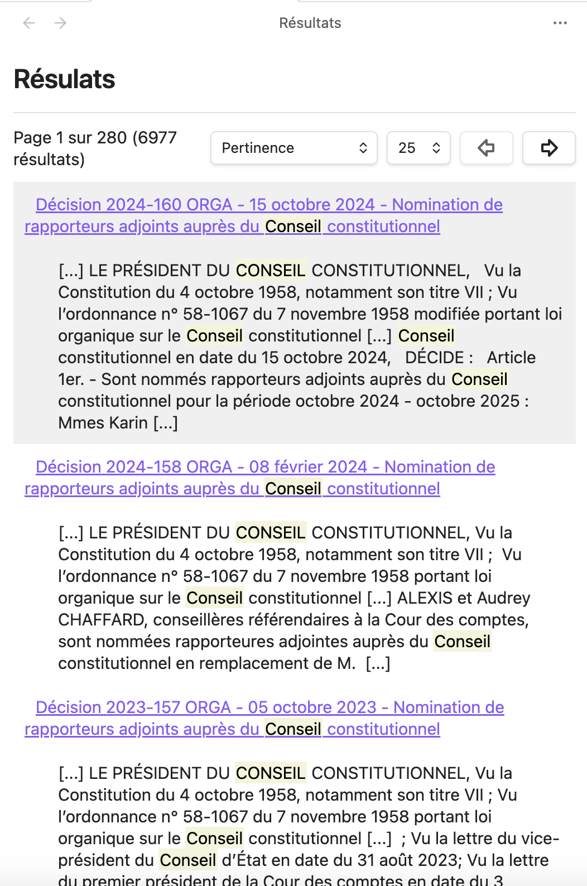
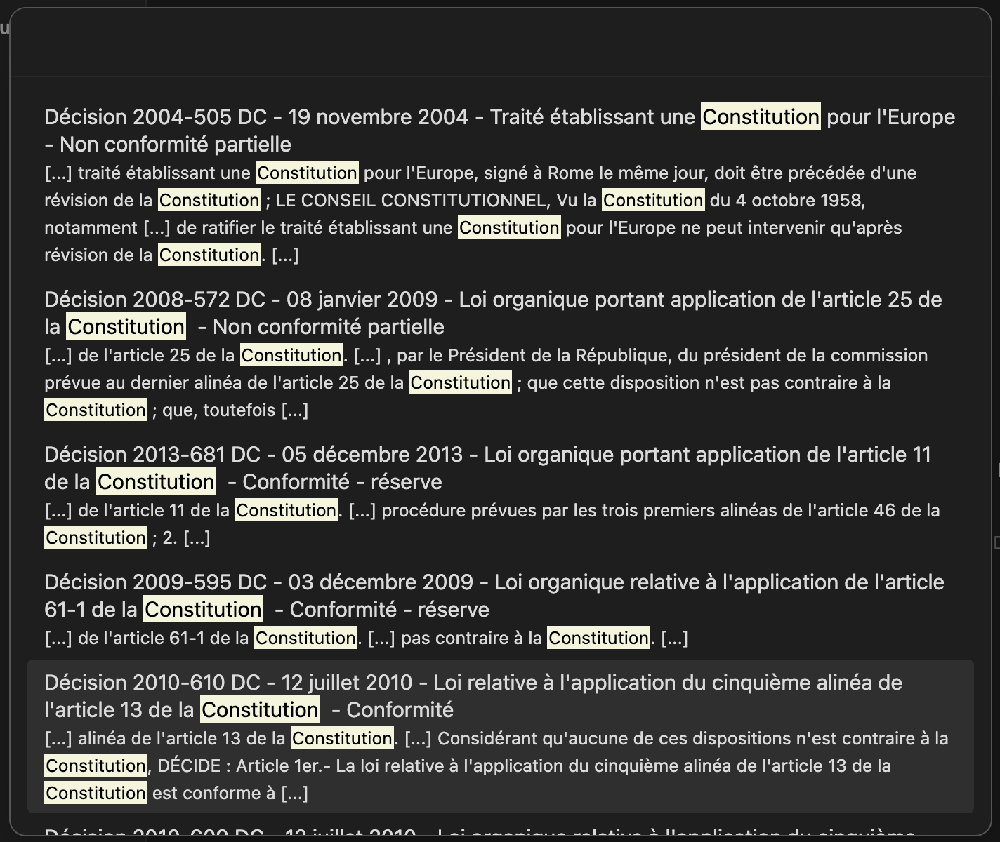
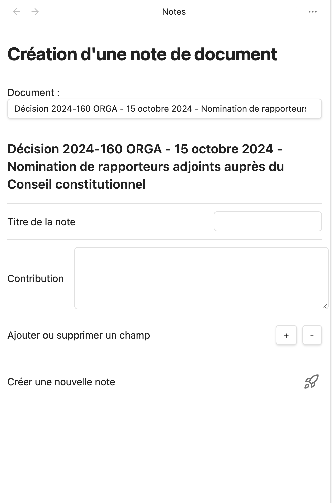
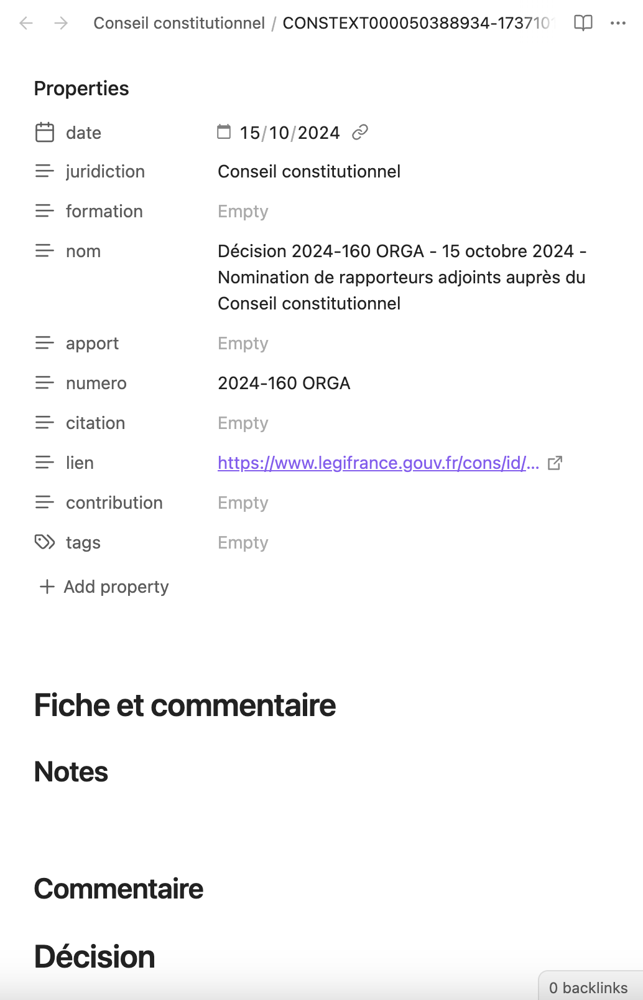
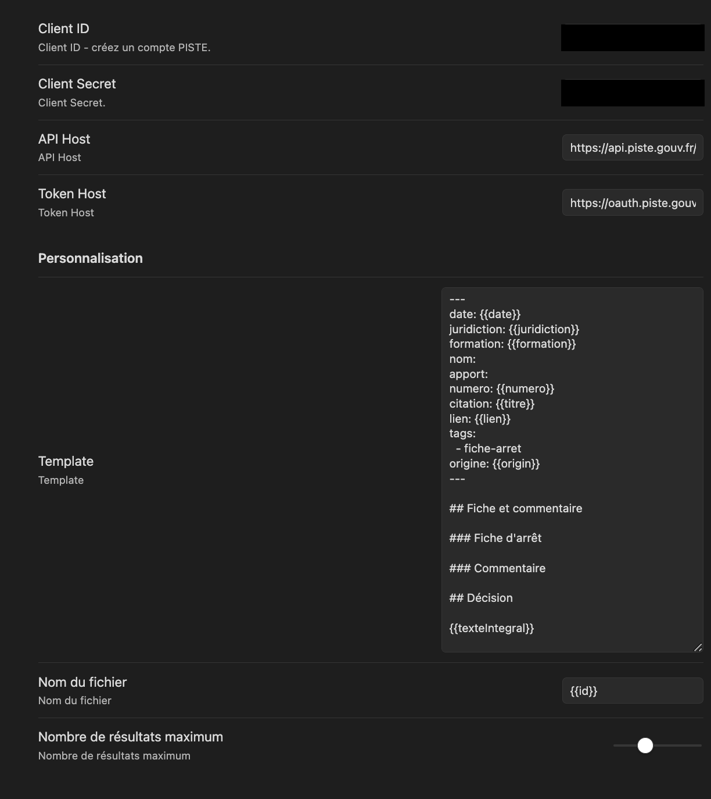

# Legifrance Integration

## Version 2.0 — votre coffre devient une base de références juridiques

Le module ne sert plus seulement à chercher et à créer des notes : il **lit vos notes** (sans LLM !) repère les décisions, lois et articles qu'elles citent, les retrouve sur Légifrance, en garde le texte et vous aide à les exploiter.

### Nouveautés

-   **Références juridiques d'une note** (commande « Afficher les références juridiques ») : un panneau liste les décisions, lois, articles de codes et textes de l'Union cités dans la note, avec leur lien Légifrance. Une référence erronée se corrige depuis le panneau.
-   **Base de données** (`legifrance.sqlite`, dans le dossier du plugin) : qui cite quoi dans le coffre, les liens Légifrance, le statut de vigueur, le texte des articles et le **texte intégral des décisions**, consultables sans nouvelle requête.
-   **Fiches de décisions** : le bouton « Compléter » renseigne les propriétés d'une fiche depuis Légifrance (date, formation, solution, ECLI…) et signale les écarts.
-   **Analyse de la jurisprudence** : chronologie, articles les plus appliqués (dans la version en vigueur le jour de la décision), généalogie entre décisions, recherche plein texte.
-   **Articles de la note** : statut de vigueur, versions, décisions qui les appliquent, et notes d'articles tenues à jour (seules les parties balisées sont réécrites).
-   **Insertion et export** : table des décisions, plan, bibliographie (Markdown, CSV, BibTeX, RIS).
-   **Création de note sans doublon** : le module vérifie que le coffre n'a pas déjà le document.
-   **Tous les fonds de l'API** : jurisprudence, codes, lois et règlements, Journal officiel, circulaires, conventions collectives.
-   **Identifiants PISTE dans le trousseau d'Obsidian** (*Réglages → Connexion à PISTE*), propre à chaque appareil. **Nécessite Obsidian 1.13.2 ou plus.**

### Pour commencer

1. Installez ou mettez à jour le module, puis ouvrez les réglages.
2. Section « Base de données » : lancez **Indexer le coffre**, puis **Compléter les décisions, articles et textes** (une à deux requêtes par référence ; le débit se règle dans « Requêtes par minute »).
3. Section « Fiches de décisions » : indiquez la propriété qui désigne vos fiches et celle qui garde l'identifiant Légifrance. Les valeurs par défaut conviennent au modèle de note fourni.
4. Ouvrez une note et affichez ses références juridiques.

> 💡 Pas encore d'identifiants PISTE ? Le module fonctionne aussi **sans API**, en mode réduit (voir [Sans identifiants PISTE](#sans-identifiants-piste-mode-sans-api)).

> 🚨 Après la mise à jour, si le module ne se lance plus, désinstallez-le puis réinstallez-le.

## Présentation

Un tuto-vidéo (réalisé pour la première version du module) est disponible ici :

## Intégration de l'API Légifrance dans Obsidian

Ce module intègre l'API Légifrance dans l'environnement de travail [Obsidian.md](https://obsidian.md/).

Grâce à vos identifiants PISTE (obtenus gratuitement via la [plateforme en ligne](https://piste.gouv.fr/)), vous pouvez désormais utiliser Légifrance directement dans Obsidian !

Très simple d'utilisation, ce module vous permet de rechercher parmi les différents fonds de données de la plateforme afin de consulter les textes directement dans Obsidian. Vous pourrez ainsi créer une note contenant les informations principales des décisions (encore en développement pour la législation et les autres documents) directement dans votre _coffre_ Obsidian.

## Comment le lancer ?

Deux solutions pour le lancer :

-   cliquer sur l'icône "⚖️" dans la barre latérale gauche ;
-   lancer la palette de commande (`Cmd+P` / `CTRL+P`) et chercher « Nouvelle recherche », « Afficher les références juridiques », etc.

## Options

-   Recherche simple parmi les fonds principaux de jurisprudence (administrative, judiciaire, constitutionnelle) ;
-   Choix du texte parmi les résultats ;
-   Personnalisation du format des notes créées (via un système très simple d'étiquettes) ;
-   Personnalisation du format des titres (même système d'étiquette) ;
-   Personnalisation du nombre de résultats souhaités (50 maximum).

### Captures d'écran

Les captures d'écran peuvent différer de votre affichage en fonction du thème choisi.

_Recherche simple et historique :_

_Affichage des résultats :_

_Editeur de notes :_

_Création de la note automatiquement :_

## Paramètres

-   Paramètres de connexion au service PISTE :
    -   Client ID (disponible après inscription au service PISTE) ;
    -   Client Secret (disponible après inscription au service PISTE);
    -   Hôte API (valeur par défaut) ;
    -   Token API (valeur par défaut).
-   Références juridiques, base de données et fiches : indexation, complément, actualisation des articles au démarrage, correspondance des propriétés des fiches ;
-   Personnalisation :
    -   Modèle de note de jurisprudence ;
    -   Modèle du titre des notes de jurisprudence ;
    -   Choix de nombre de résulats affichés (5 min, 50 max).

### Les modèles

Vous pouvez personnaliser le modèle de note qui sera créée comme vous l'entendez. Pour cela, utilisez la zone de texte à cet effet dans les paramètres. Le moteur de modèle est Handlebars JS (j'utilisais Mustache avant mais Handlebars offre de plus grandes possibilités). Pour afficher une valeur, il suffit de l'encadrer entre deux paires d'accolades.

ex. `{{titre}}`

Voilà les variables accessibles :

-   `{{ titre }}` - titre de l'entrée. Correspond en général à la citation de la décision
-   `{{ id }}` - l'identifiant de la décision sur la base de données de Légifrance
-   `{{ lien }}` - lien vers le site de Légifrance
-   `{{ origin }}` - Fond dans lequel se trouve la décision
-   `{{ texteIntegral }}` - Le texte intégral de la décision
-   `{{ numero }}` - Le numéro de l'affaire, de la décision
-   `{{ date }}` - Date de la décisions sous la forme YYYY-MM-DD
-   `{{ annee }}` - Année de la décision
-   `{{ juridiction }}` - Juridiction qui a rendu la décision
-   `{{ formation }}` - Formation de la juridction
-   `{{ solution }}` - Solution de la décision
-   `{{ urlCC }}` - Lien vers le site du Conseil constitutionnel pour les décisions du Conseil constitutionnel
- `{{ contributionNote }}` - Contribution ajoutée dans l'éditeur de note. Champ par défaut, qui permet d'ajouter une sorte de courte description du document consulté
-   `{{#sommaires}} {{resume}} {{/sommaires}}` (c'est une liste qui peut contenir plusieurs entrées. La syntaxe ici permet de faire une boucle et d'afficher toutes les entrées) - Liste des sommaires.
- `{{#each notes}} {{this.titreChamp}} {{this.valeurChamp}} {{/each}}` (idem, avec une liste qui contient des objets avec une variable `titreChamp` et une autre `valeurChamp`).

> 🚨 Je ne sais pour quelle raison pour l'instant, mais assurez-vous qu'il n'y ait pas d'espace entre les deux accolades et le mot clef (ie. ne pas faire `{{ #each }}` mais bien `{{#each}}` sans quoi le moteur de template ne fonctionne pas). 🚨

Pour aller plus loin, vous pouvez consulter la [documentation de Handlebars](https://handlebarsjs.com). Une fonctionnalité utile, peut être, par exemple, d'intégrer un affichage conditionnel lorsque vous ne souhaitez pas utiliser l'éditeur de note d'arrêt, en utilisant le bloc `{{#if variable}} {{variable}} {{/if}}`.

## Comment utiliser le module

### Installer le plugin

Vous pouvez installer le module directement depuis le store de l'application. C'est plus facile ainsi.

### Utilisation de l'API Légifrance

1. Créez un compte sur l'application PISTE : https://piste.gouv.fr/ ;
2. Dans l'onglet `Applications`, créez une nouvelle application ;
3. Entrez le nom que vous souhaitez donnez à cette connexion, renseignez les informations nécessaires. Laissez la case `Activer l'application` cochée. Cliquez sur `Sauvegarder l'application` ;
4. Cliquez sur `Cliquez ici pour accèder à la page de consentement` : c'est une étape importante pour accepter les conditions d'utilisation du service. Sélectionnez le service _Légifrance_ et acceptez les conditions d'utilisation ;
5. Retournez sur la page de l'application créée et sélectionnez l'application `Légifrance` afin d'activer l'accès à l'API. Validez ;
6. Récupérez les identifiants de connexion dans l'onglet de l'application `Authentification`. Il y a là deux types de codes - il faut sauvegarder, dans un lieu secret et accessible de vous uniquement, le `Client ID` et le `Client Secret` (il faut cliquer sur `Consulter le client secret`) de la section OAuth (deuxième volet des identifiants) ;
7. Une fois ces identifiants récupérés, vous pouvez les insérer dans les paramètres du module ! C'est tout !

### Sans identifiants PISTE (mode sans API)

Les identifiants sont facultatifs. Sans eux :

-   **Ça marche** : le repérage des références dans les notes (soulignement, aperçu, dictionnaire de lois), le panneau des références, l'indexation du coffre, ArianeWeb, la Revue générale du droit et le site du Conseil constitutionnel.
-   **Ça ouvre le site** : une référence (Cmd/Ctrl + clic, ou icône du panneau) et la recherche ouvrent legifrance.gouv.fr dans le navigateur.
-   **Seulement si déjà en base** : la lecture d'un texte ou d'une décision, et l'aperçu.
-   **Il faut des identifiants** pour les liens exacts, la table des matières des codes, le complément des décisions et des fiches, le statut de vigueur et les notes d'articles.

Saisir ses identifiants plus tard suffit, sans rien réinstaller.

Ces étapes sont aussi dans les réglages du plugin (*Connexion à PISTE → Premiers pas*). Le bouton **Tester la connexion** vérifie vos identifiants puis l'accès à l'API Légifrance, et indique l'étape à corriger en cas d'échec (identifiants refusés, consentement ou activation de l'API manquants, PISTE injoignable).

## TO-DO

-   [x] Intégration d'un éditeur de fiche d'arrêt.
-   [x] Visualisation des documents dans Obsidian dans une fenêtre, sans insertion dans une note.
-   [x] Recherche, lecture et création de notes dans tous les fonds : jurisprudence (Conseil constitutionnel, juridictions administratives, judiciaires et financières, CNIL), législation (lois et règlements en vigueur ou à une date, codes, Journal officiel, circulaires), conventions collectives et accords d'entreprise.
-   [x] Recherche complexe : intégration des opérateurs booléens.
-   [x] S'assurer que les _views_ persistent après redémarrage.
-   [x] Gestionnaire d'historique.
-   [x] Meilleur moteur d'affichage des résultats.
-   [x] Lecture d'un code par sa table des matières (commande « Parcourir un code », ou clic sur le titre d'un code dans les résultats) : sections dépliables, filtre par numéro d'article, version à une date.
-   [x] Lecteur d'article : chemin dans le code, choix de la version, article précédent / suivant, renvois cliquables.
-   [x] Lecteur : recherche dans le texte (Cmd/Ctrl + F, ou bouton « Rechercher »), plan de navigation, fiche du document détaillée (ECLI, NOR, publication, copie de la citation).
-   [x] Panneau de recherche : un seul formulaire (termes, fond en liste déroulante, façon de chercher), critères supplémentaires et période sous « Options ».
-   [x] Liens Légifrance redirigés vers le plugin : un clic (notes en lecture, propriétés, panneaux ; Cmd/Ctrl + clic dans l'éditeur) ouvre le texte dans le lecteur, depuis la base ou l'API ; Maj + clic ouvre le site ; aperçu du texte au survol (réglages « Ouvrir les liens Légifrance dans le plugin » et « Aperçu au survol »).
-   [x] Références juridiques repérées dans le texte des notes (soulignement discret en pointillés, éditeur et lecture), aperçu au survol depuis la base, Cmd/Ctrl + clic pour ouvrir dans le lecteur (sur mobile : un tap ouvre l'aperçu, sans ouvrir Légifrance) (réglage « Repérer les références juridiques dans les notes »).
-   [x] Dictionnaire de lois personnalisé : vos abréviations et noms usuels (« LCEN | loi confiance numérique = loi 2004-575 ») sont reconnus en plus de ceux du plugin (réglage « Lois et abréviations personnalisées »).
-   [x] Résultats de recherche refaits : cartes, tri (API ou sur la page), filtre par origine, passages trouvés dans le texte.

### Base de données des références juridiques

Le plugin tient, dans le dossier du plugin, une base SQLite (`legifrance.sqlite`, via sql.js : elle fonctionne aussi sur mobile) qui recense les références juridiques de **toutes** les notes du coffre : décisions, lois, articles de codes, droit de l'Union. Elle conserve pour chaque note qui cite quoi (et combien de fois), les liens Légifrance retrouvés et le texte des articles.

-   **Indexer le coffre** (réglages) analyse toutes les notes ; ensuite la base suit les créations, modifications, renommages et suppressions de notes.
-   **Compléter les fiches de décisions** retrouve chaque décision sur Légifrance et enregistre sa date, sa formation, sa solution, son ECLI et son texte intégral (une requête par décision ; reprenable).
-   Tables principales : `notes`, `refs`, `citations`, `links`, `misses`, `decisions`, `decision_articles`, `decision_relations`, `fiches`, `article_versions`, `documents` — le fichier s'ouvre avec n'importe quel outil SQLite (copiez-le hors du coffre pour le lire).

### Fonctionnalités intéressantes à développer (si le temps le permet)

-   [x] Un _parser_ permettant de lister facilement tous les textes juridiques présents dans le coffre ;
    -   [x] _Parser_ de décisions.
    -   [x] _Parser_ de textes législatifs.
-   [x] Un _parser_ des notes : liste des décisions, textes et articles cités, avec liens Légifrance, dans un panneau latéral (commande « Afficher les références juridiques »). Pistes : reconnaître davantage de formats de citation, ouvrir les documents retrouvés dans le lecteur du plugin.
-   [x] Une prévisualisation des textes (peut-être sous la forme d'un pop-up lorsqu'on passe la souris au dessus d'un lien lié à Légifrance ?)

## Discord

Pour venir discuter du plugin ou de l'utilisation, en général, des outils numériques en droit, vous pouvez rejoindre le serveur Discord suivant :

https://discord.gg/ha3Vsk6DNQ

## Roadmap

- [ ] Ajout de Judilibre dans les sources
- [ ] Ajout d'autres fonds (si vous avez des idées / besoins, n'hésitez pas !)

### Idées (à trier)

-   [ ] Dictionnaire d'abréviations pour les codes (« CPC », « C. trav. »), import / export des dictionnaires, suggestion des sigles non reconnus.
-   [ ] Citations coupées par du gras ou de l'italique en mode lecture ; plus de formats (JCP, D., RTD civ., circulaires) ; commande « Pourquoi cette citation n'est-elle pas reconnue ? ».
-   [ ] Article d'une loi retrouvé dans l'arbre du texte (aujourd'hui, le lien est celui de la loi entière).
-   [ ] Mobile : bouton « Ouvrir » dans la carte ; aperçu au tap sur les liens Légifrance.
-   [ ] Création de la fiche ou de la note d'article depuis la carte d'aperçu.
-   [ ] Références abrogées ou modifiées marquées dans le texte ; version applicable à la date des faits.
-   [ ] « Où ai-je cité ça ? » dans le lecteur ; table des textes cités d'un chapitre ; revirements cités sans la décision revue.
-   [ ] Téléchargement des archives ouvertes de la DILA, pour lire hors ligne sans API.
-   [ ] Tests de l'interface.

## Confidentialité et divulgations

- **Réseau** : le plugin n'envoie de requêtes qu'à Légifrance (API PISTE : `api.piste.gouv.fr`, `oauth.piste.gouv.fr`) et, pour retrouver une décision absente de Légifrance, à ArianeWeb (`conseil-etat.fr`), à la Revue générale du droit (`revuegeneraledudroit.eu`, via `public-api.wordpress.com`) et au site du Conseil constitutionnel (`conseil-constitutionnel.fr`). Aucune donnée n'est envoyée ailleurs et le plugin n'a ni télémétrie ni publicité. Le contenu de vos notes ne quitte jamais votre ordinateur : seules les références juridiques repérées (« Cass. civ. 1re, 3 mars 2020, n° 19-12.345 ») servent à formuler les requêtes.
- **Identifiants PISTE** : conservés dans le trousseau d'Obsidian (`SecretStorage`), jamais dans `data.json`.
- **WebAssembly** : `main.js` embarque SQLite compilé en WebAssembly ([sql.js](https://github.com/sql-js/sql.js), `sql-wasm.wasm`) pour la base de références. Aucun autre binaire, aucun accès à des fichiers hors du coffre.
- **Parcours du coffre** : l'indexation lit les notes Markdown (API Obsidian) pour y repérer les références juridiques. Seules les propriétés des fiches (et les parties balisées des notes d'articles) sont écrites, et toujours par l'API d'Obsidian.
- **Presse-papiers** : écrit uniquement à votre demande (export de la bibliographie vers le presse-papiers, bouton « Copier le diagnostic »). Il n'est jamais lu.
- **Stockage du navigateur** : le plugin retient seulement quelles rubriques du panneau des références sont repliées.
- **Provenance** : les fichiers de chaque release (`main.js`, `styles.css`) sont accompagnés d'une attestation GitHub qui prouve qu'ils sortent de ce dépôt (`gh attestation verify main.js --repo carnetdethese/legifrance-integration`).

## Soutien

Si vous souhaitez soutenir le projet, vous le pouvez via ce lien :

## Note sur l'utilisation de l'IA pour le développement

La première version du plugin (Légifrance Intégration v1) a été développée sans IA (ou marginalement). J'avais laissé le développement de côté par manque de temps et par blocage technique. L'amélioration des outils d'IA génératifs m'ont permis de redonner vie à ce projet.

La v2 est donc le résultat d'une expérimentation avec Claude code (j'ai utilisé Sonnet 5.5, Medium / Élevé) pour pousser plus loin les capacités du module et intégrer tout ce que j'avais envisagé lorsque j'ai commencé le projet. Je me suis assuré, à chaque étape, que les fonctionnalités ajoutées répondaient correctement à mes attentes, avec un processus itératif complet, la mise en place de tests visant à éviter les régressions, et de plusieurs audits, à différents stades de développement, visant à vérifier l'absence de failles de sécurité, l'amélioration de la performance et le maintien de l'intégrité à tout moment des notes. 

Je n'ai intégré, dans le plugin lui-même, aucune fonctionnalité d'IA, par choix. Si les LLM m'aident à développer, je ne souhaite en revanche pas leur soumettre l'intégralité de mes notes. 

Je n'ai sans doute pas le worflow parfait, mais je pense m'en être plutôt bien sorti et avoir réussi à produire un module fiable et utile pour le travail des juristes sur Obsidian ! 